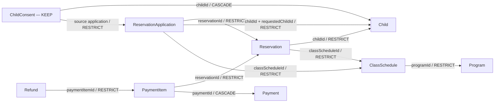

# Task — Cleanup plan for manual-CAJEueoBL-mar339n7TazQ

- Status: **PLAN ONLY. No deletion or database mutation is authorized or executed.**
- Prepared: 2026-10-20, against repository HEAD `5447f83`.
- Exact runId: `manual-CAJEueoBL-mar339n7TazQ` (called `R` below).
- Deliverable: this document only; no cleanup script, API call, migration, or runtime change.

## Supplement (2026-10-20 00:46 KST) — Actual DB Facts

User confirmed from yaho-preview actual DB:

| Item | Value |
|------|-------|
| Program ID | `cmvf8y83f0000jq08kcidbqp0` |
| Connected classes | 1 |
| Target applications | 2 |
| Connected ChildConsent records | 6 |

### ChildConsent Preservation Impact

Under current audit/consent preservation policy (ADR-008/054/055):

- **6 ChildConsent rows are KEEP_AUDIT** — cannot be deleted
- Each ChildConsent references:
  - `childId → Child` (CASCADE — deleting Child would destroy consent)
  - `reservationApplicationId → ReservationApplication` (RESTRICT — blocks application deletion)
- **Consequence**: The 2 applications, their 2 Children, 2 Reservations, 1 ClassSchedule, and Program `cmvf8y83f0000jq08kcidbqp0` are all **blocked from deletion** by FK constraints
- Payment/Refund records linked to these Reservations are also blocked

### Non-deletable Scope (Definitive)

| Record | Reason |
|--------|--------|
| 6 ChildConsent | Audit preservation policy |
| 2 Child | Referenced by preserved consents (CASCADE would destroy) |
| 2 ReservationApplication | Referenced by preserved consents (RESTRICT) |
| 2 Reservation | Referenced by applications (RESTRICT) |
| 1 ClassSchedule | Referenced by reservations/applications (RESTRICT) |
| 1 Program (`cmvf8y83f0000jq08kcidbqp0`) | Referenced by class (RESTRICT) |
| Payment/PaymentItem/Refund | Linked to blocked Reservations |

**Result**: Complete physical deletion is **impossible** without violating audit policy.

### Program Ownership Note

Program `cmvf8y83f0000jq08kcidbqp0` has 1 connected class. However:
- Program was created BEFORE runId assignment
- Single class connection does not prove exclusive test ownership
- Program has no `syntheticRunId` field
- **Ownership remains UNPROVEN** — requires original creation evidence

## Goal

Identify how a future, separately authorized cleanup could remove proven synthetic data for `R` in reverse foreign-key dependency order while preserving audit evidence, shared records, and all non-test data. Explain why a Program created before runId assignment needs independent ownership proof and why complete physical cleanup may be impossible under the audit-preservation rule.

## Current State

| Evidence | Finding |
| --- | --- |
| User-provided fact | The Program was created **before** this runId was assigned. Its exact ID and synthetic provenance are not provided in this request. |
| Repository inspection | The exact runId was not found in the inspected pre-existing repository or local Memory files. No run-specific row IDs or counts have been established. |
| Administrative manual flow | [`markGroupManualTestSession`](../app/(admin)/reservation-applications/actions.ts) generates `manual-` plus 22 base64url characters and updates an existing group's `syntheticRunId` and `syntheticSettings`. It does not tag or create its Program, ClassSchedule, Child, or existing submissions. |
| Program creation | [`createProgram`](../app/(admin)/programs/actions.ts) creates an ordinary Program with a generated ID and operational fields. Program has no `runId`, `syntheticRunId`, or creator audit field. |
| Separate manual runtime | [`server/manual-test/persistence.ts`](../server/manual-test/persistence.ts) uses explicitly qualified `manual_test` tables with per-row `runId`, composite FKs, and a retained `ManualTestRun` tombstone. This is a separate system from the administrative group marking above. |
| Execution evidence | No database connection, live inventory, SQL execution, cleanup endpoint, backup, or deletion rehearsal was performed for this plan. Target database identity, deployed schema, row ownership, and backup availability remain unverified. |

The administrative flow is the planning hypothesis because it permits the reported Program-before-runId sequence. A matching `manual-*` string alone does not prove which system contains this run. Before any future execution, independently confirm the approved nonproduction database and the schema used by the actual request. The main Prisma models below describe the normal business schema, ordinarily `public`; verify the deployed mapping rather than assuming it from a connection name.

If the run instead belongs only to `manual_test`, stop this business-schema procedure and use a separately reviewed private-schema plan. Its existing cleanup clears synthetic consent/receipt rows and other run data, so it must not be invoked as a shortcut around this request's audit-preservation rule. Do not query or delete both schemas speculatively. Historical cleanup approvals recorded elsewhere are not authorization for this run.

### Sources reviewed

- [`prisma/schema.prisma`](../prisma/schema.prisma), especially the business, consent, account-change, and publication models.
- FK SQL in the [initial migration](../prisma/migrations/20260820050000_init/migration.sql), [consent/attendance actor migration](../prisma/migrations/20260825090000_phase6_safety_attendance/migration.sql), [account-access migration](../prisma/migrations/20260913170000_phase16_account_access_management/migration.sql), [Phase 18 migration](../prisma/migrations/20260929073840_phase18_reservation_applications/migration.sql), and [Phase 20 migration](../prisma/migrations/20261006090000_phase20_reservation_application_enhancements/migration.sql).
- [`REQUIREMENTS.md`](../REQUIREMENTS.md), [`ARCHITECTURE.md`](../ARCHITECTURE.md), and [`docs/DECISIONS.md`](DECISIONS.md): ADR-008, ADR-049, ADR-054–060, and the existing preference for preserving business history.
- [`groups.ts`](../server/reservation-applications/groups.ts), [`preview-manual-session.ts`](../lib/e2e/preview-manual-session.ts), [`phase20-cleanup.ts`](../lib/e2e/phase20-cleanup.ts), [`preview-cleanup.ts`](../lib/e2e/preview-cleanup.ts), and the [manual apply SPEC](MANUAL_APPLY_TEST_SPEC.md).
- The [Mock AI migration](../prisma/migrations/20261014090000_phase21_ai_consultations_mock/migration.sql), [AI service migration](../prisma/migrations/20261015090000_ai_service_followup/migration.sql), and [private manual runtime documentation](MANUAL_TEST_RUNTIME.md), for additional blockers and boundaries.

## Data Model

No schema change or migration is proposed. Here, `dependent.fk → parent.id` means the dependent references the parent: the dependent must disappear first if the parent is eligible for deletion. `CASCADE` and `SET NULL` describe database behavior, not permission to remove evidence. Required relations with omitted `onDelete` in Prisma were cross-checked against migration SQL and are `RESTRICT` below. Deployed constraints and triggers must still be checked before execution.

### Core FK relationships

| Dependent FK | Parent | ON DELETE | Cleanup implication |
| --- | --- | --- | --- |
| `ClassSchedule.programId` | Program | RESTRICT | Every retained class blocks its Program. |
| `Reservation.classScheduleId` | ClassSchedule | RESTRICT | Reservation precedes class deletion. |
| `Reservation.childId` | Child | RESTRICT | Reservation precedes Child deletion. |
| `ReservationApplication.classScheduleId` | ClassSchedule | RESTRICT | Application precedes class deletion, even if unconfirmed. |
| `ReservationApplication.childId` | Child | RESTRICT | Confirmed application precedes its linked Child. |
| `ReservationApplication.requestedChildId` | Child | RESTRICT | Repeat-child selection also blocks Child deletion. |
| `ReservationApplication.reservationId` | Reservation | RESTRICT | Application must precede Reservation; several applications may reference the same Reservation. |
| `ReservationApplication.submissionId` | ReservationApplicationSubmission | RESTRICT | Application precedes submission. |
| `PaymentItem.reservationId` | Reservation | RESTRICT | PaymentItem precedes Reservation; this FK is unique. |
| `PaymentItem.paymentId` | Payment | CASCADE | Inspect **all** items of a Payment; never let deleting a Payment remove an unreviewed item. |
| `Refund.paymentItemId` | PaymentItem | RESTRICT | Refund precedes its item; it does not point directly to Payment or Reservation. |
| `ChildConsent.childId` | Child | CASCADE | Child deletion would destroy consent history. Keep any Child with preserved consents. |
| `ChildConsent.reservationApplicationId` | ReservationApplication | RESTRICT | A preserved consent blocks the source application. Null source IDs still leave the Child protected. |
| `ChildSafetyInfo.childId` | Child | CASCADE | Safety rows require separate ownership review before their Child can be removed. |
| `Relationship.childAId`, `childBId` | Child | CASCADE | A relationship touching a non-test Child is a shared dependency; retain it and its required parents. |
| `ClassTeacher.classScheduleId` | ClassSchedule | CASCADE | Review and explicitly account for each assignment before class deletion; retain Teacher records. |



Arrows above point from dependent to parent; labels describe what would happen when the parent is deleted. In particular, Program is a root near the **end** of deletion order, not the starting point.

### Additional dependencies that must be inventoried

| Dependent FK(s) | Parent(s) and ON DELETE | Required review |
| --- | --- | --- |
| `ReservationApplicationGroupClass.groupId`, `classScheduleId` | Group CASCADE; ClassSchedule RESTRICT | Inspect all memberships of each candidate class, including other groups. |
| `ReservationApplicationGroup.upgradedLegacyClassScheduleId` | ClassSchedule RESTRICT | An upgraded legacy group can block a class independently of membership rows. |
| `ReservationApplicationLink.groupId`, `classScheduleId` | Group RESTRICT; ClassSchedule RESTRICT | Both group links and legacy class links must be checked. |
| `ReservationApplicationSubmission.groupId` | Group RESTRICT | A retained submission blocks its group. |
| `ApplicationDeposit.submissionId` | Submission RESTRICT | Financial record; never classify it from payer name or time alone. |
| `ReservationApplicationPaymentMapping.applicationId`, `paymentItemId` | Application RESTRICT; PaymentItem RESTRICT | Mapping precedes both; inspect both endpoints for foreign ownership. |
| `ReturnObligation.submissionId`, `applicationId` | Submission RESTRICT; Application RESTRICT | Include rejected, cancelled, and excess-funds obligations, including null application IDs. |
| `ApplicationReturn.returnObligationId` | ReturnObligation RESTRICT | Return precedes obligation; it is distinct from Refund. |
| `FundAllocation.depositId`, `paymentMappingId`, `returnObligationId` | All RESTRICT | Allocation precedes every populated parent; check the complete finance component. |
| `CompanionInvite.issuerSubmissionId`, `groupId`, `companionGroupId` | Submission CASCADE; Group RESTRICT; CompanionGroup CASCADE | Unexpected companion activity is a blocker until independently classified. |
| `CompanionGroup.groupId`, `issuerSubmissionId` | Group RESTRICT; Submission RESTRICT | A shared issuer or member prevents deleting the companion group. |
| `CompanionGroupMember.companionGroupId`, `submissionId` | Both CASCADE | Explicitly review all members before either parent is removed. |
| `DeviceSubmission.deviceId`, `submissionId` | ApplicationDevice CASCADE; Submission CASCADE | Device may span multiple runs and submissions. |
| `DeviceChild.deviceId`, `childId` | ApplicationDevice CASCADE; Child RESTRICT | Review **all** device-child associations, not just those found through this run's submissions. |
| `AiProgramPublication.programId`, `AiClassPublication.classScheduleId` | Program RESTRICT; ClassSchedule RESTRICT | Check every run's publications, not just `runId = R`. |
| `AiServiceProgramPublication.programId`, `AiServiceClassPublication.classScheduleId` | Program RESTRICT; ClassSchedule RESTRICT | These use environment ownership, not runId. Preserve by default. |

### Audit and actor references

- **ChildConsent:** append-only evidence under ADR-008/054/055. It references Child and optionally its source application as above. `recordedById → User` is `SET NULL`; do not delete a User to erase the actor.
- **UserAccountChange:** the implemented account audit table. Both `targetUserId → User` and `actorAdminId → User` are `RESTRICT`. It has no Program, ClassSchedule, Child, Reservation, or runId FK, so no such cleanup selector exists. Preserve every row and both User endpoints.
- **Business processing evidence:** application deposit/resolution/purge actors, Child purge actors, submission updates, group creators, link issuers, deposit confirmers, return processors, and settings editors reference User with `RESTRICT`. Class cancellation, Reservation cancellation/attendance, Refund processing, and safety-info update actors use `SET NULL`. These references never make the operating account a test-owned object. Keep Users and actor fields intact.
- There is **no generic `AuditLog` model** in the inspected Prisma schema. Account history is not a system-wide Program creation log. Future catalog inspection must account for any additional deployed audit table or trigger; its absence cannot be inferred from this local schema alone.
- AI service financial evidence is separate: `AiServiceReconciliation(environment, month) → AiServiceBudgetMonth(environment, month)` and the equivalent AiServiceRequest relation are `RESTRICT`. Migration triggers prohibit deleting AiServiceBudgetMonth and updating/deleting AiServiceKeyPin or AiServiceReconciliation. None is a business-run cleanup target. Preserve anonymous `AiDailyMetric` and `AiServiceDailyMetric` aggregates too.

## Ownership and Read-only Inventory Plan

### Establish the run boundary

1. Confirm the exact nonproduction database, deployed schema/migration state, and the actual manual flow used. Do not expose connection strings, cookies, link tokens, bank settings, or personal information. No live inventory is performed by this document.
2. In the confirmed business schema, select groups with **exact equality** `syntheticRunId = R`. Record the complete expected group-ID set; the column is indexed, not unique. An absent group is not proof that all run data is gone and does not permit a name-based fallback.
3. Read each group's links, submissions, applications, and memberships. Collect candidate classes from current memberships **and** historical `ReservationApplication.classScheduleId` and linked `Reservation.classScheduleId`. Group membership can change while existing applications retain their original class, so current memberships alone are incomplete.
4. Follow each application to `childId`, `requestedChildId`, and `reservationId`. Include legacy/reused Reservations and applications without payment mappings. Discover PaymentItems from **both** Reservation IDs and application-payment mappings; follow each item to its Payment and Refunds. Inspect every other item of those Payments, not merely mapped items.
5. Inventory deposits, returns, obligations, allocations, consents, device associations, companions, legacy links/upgraded groups, safety information, relationships, teacher assignments, and AI publications. Inspect incoming references from outside the candidate set and outgoing links to shared parents. A join discovers candidates; it does not prove that a connected row was created by this test.
6. Classify every qualified table/ID as `DELETE_CANDIDATE`, `KEEP_AUDIT`, `KEEP_SHARED`, or `UNKNOWN_KEEP`. Record its provenance, expected state/version or timestamps where present, dependency IDs, and reason in a private review manifest. Do not put personal data or raw settings in this repository. Classification does not authorize deletion.

The following is a **read-only discovery example**, not an executed query or deletion selector. Use it only after confirming that `public` is the actual approved business schema. A future inventory must also include historical classes and the complete dependency checks above.

```sql
SELECT g."id" AS "groupId", g."createdAt" AS "groupCreatedAt",
       gc."classScheduleId", c."createdAt" AS "classCreatedAt",
       p."id" AS "programId", p."createdAt" AS "programCreatedAt",
       p."status" AS "programStatus"
FROM "public"."ReservationApplicationGroup" AS g
LEFT JOIN "public"."ReservationApplicationGroupClass" AS gc ON gc."groupId" = g."id"
LEFT JOIN "public"."ClassSchedule" AS c ON c."id" = gc."classScheduleId"
LEFT JOIN "public"."Program" AS p ON p."id" = c."programId"
WHERE g."syntheticRunId" = 'manual-CAJEueoBL-mar339n7TazQ'
ORDER BY g."id", gc."classScheduleId";
```

### Identify the Program created before runId assignment

- Start with the exact Program ID reached through the reviewed class IDs, then reconcile it with the original creation response/admin detail URL or an existing test-session record and operator confirmation that it was created solely for this synthetic test. The request establishes creation order, but does not supply the identity or proof.
- Program names, descriptions, and memos are mutable and nonunique. A synthetic-looking name or a `TEST`/`manual` substring is corroboration only. Do not use a broad name match, a timestamp range, `createdAt >= run start`, `updatedAt`, zero price, inactive status, or lack of current reservations as ownership proof.
- In particular, a `createdAt >= runId assignment` filter would miss this Program. Conversely, a Program older than the run can be a legitimate reusable Program. The group marking timestamp is not separately stored; its mutable `updatedAt` is not a reliable marking event or creation audit.
- The marking action can label an existing group without checking whether its prior submissions or classes are synthetic. A matching group does not retroactively prove all existing descendants are test data. Inspect preexisting activity as well as activity after marking.
- Inspect **all** ClassSchedules using the Program, including classes outside this group/run, and all Mock/service publications referencing it. A real, shared, unknown, or audit-protected dependent means keep the Program. Do not expand the deletion set to those dependents to make the Program deletable.
- Even with exclusive synthetic provenance, the Program becomes eligible only after every reviewed dependent is eligible and removed, with no protected consent/application/class chain remaining. If provenance is unavailable or ambiguous, record `UNKNOWN_KEEP` for that exact Program ID. Leaving an unproven Program is an expected safe outcome.

## What Cannot Be Deleted

These are constraints on the proposed future cleanup, including indirect cascade effects:

| Protected data | Required handling |
| --- | --- |
| Audit logs, all UserAccountChange rows, and all ChildConsent rows | Preserve unchanged, including records produced during this test. Do not detach source applications, null actor IDs, rewrite audit payloads, or cascade through Child. |
| Parents required by preserved audit rows | Retain Child and the source application; recursively retain its submission/group, Reservation, ClassSchedule, and Program as required by populated FKs. Keep the associated confirmed application/reservation/finance branch coherent rather than deleting only its financial evidence. |
| Records referenced by any real, other-run, shared, or unclassified data | Keep the record and every parent required by the retained row. A CASCADE edge is a blocker just as a RESTRICT edge is; do not silently remove the referencing row or reassign its FK. |
| Real or unproven Child, Reservation, Payment, PaymentItem, Refund, deposit, allocation, mapping, obligation, or return | Keep. Existing-child selection and reused Reservations do not transfer ownership to `R`. Actual financial records remain subject to the existing retention policies; this plan invents no retention period or refund policy. |
| Mixed Payment or finance component | If even one item, allocation endpoint, mapping, deposit, obligation, or return is outside the approved synthetic set, preserve the affected finance branch and its required parents. Do not recalculate real totals to permit partial removal. |
| Shared ApplicationDevice, companion group, relationship, or teacher assignment | No parent cascade across a real/other-run association. Only independently proven removable association rows could be considered; the shared parent remains. |
| Operating Users, Teachers, authentication/session data, and ReservationApplicationSettings singleton | Out of scope. Keep identities, accounts, settings, and their audit actors. Group `syntheticSettings` is a snapshot, not ownership of the source singleton. |
| AI service ledgers, key pins, reconciliations, anonymous metrics, and other-run/service publications | Preserve. A retained publication blocks the referenced class/Program. Do not disable triggers, RLS, or FK constraints to proceed. |
| PreviewE2eRunLease and private manual-test control records | No blanket lease/session/control cleanup. The administrative `manual-*` run does not establish automated lease ownership. Private-schema run tombstones and any audit evidence remain outside this procedure. |
| Prisma migration history, schema objects, platform/auth storage, other runs, and all Production data | Entirely out of scope. No reset, truncate, schema drop, `prisma migrate reset`, or `prisma db push`. |

ADR-057/058 provide a narrowly defined retention-expiry exception for deleting consent history while anonymizing eligible Child records. That is a separate ADMIN retention workflow, not authorization to delete fresh test consents or run a global purge here. Do not age records artificially or invoke that workflow for cleanup.

Apply preservation to a fixed point: once a row is marked KEEP, mark every parent needed to preserve its FKs as KEEP, and reject any proposed deletion that would cascade into a KEEP row. Re-evaluate coherent finance branches as well. Derive the final deletion set **after** this propagation. If nothing remains eligible, report that result; complete physical erasure is not a success requirement.

## Deletion Order — Reverse FK Dependencies

This is a future ordering specification, **not commands to execute**. Each row mentioned must independently qualify as a proven synthetic, approved deletion candidate. The order applies to the eligible subgraph remaining after all KEEP propagation; it does not instruct deletion of protected blockers.

**Consent prerequisite:** FK topology would require ChildConsent to disappear before its source application and Child. Since this plan preserves ChildConsent, there is no consent-deletion step. Any application or Child with a retained consent, and its required ancestors, must instead leave the deletion set. UserAccountChange likewise has no deletion step.

| Step | Eligible rows, if any | Required predecessors / checks |
| --- | --- | --- |
| 1 | CompanionInvite, CompanionGroupMember, DeviceChild, DeviceSubmission | Review all endpoints first. No cascade into other submissions/children; keep protected associations. |
| 2 | Unshared ApplicationDevice and CompanionGroup | Their reviewed joins/invites from step 1 must be gone; no remaining foreign association. |
| 3 | Proven synthetic Refund, ApplicationReturn, FundAllocation | These leaves precede PaymentItem, ReturnObligation, deposits, and mappings. Real/unknown financial evidence is never eligible. |
| 4 | ReservationApplicationPaymentMapping, ReturnObligation, ApplicationDeposit | Allocation and return prerequisites from step 3 must be gone; mapping precedes both application and item. |
| 5 | ReservationApplication | No retained ChildConsent, payment mapping, or ReturnObligation may reference it. This must precede Reservation and submission deletion. |
| 6 | PaymentItem | Refunds and mappings must be gone. Check the entire Payment component; no partial deletion of a mixed Payment. |
| 7 | Payment | Every item must have been explicitly accounted for and removed; do not depend on Payment's CASCADE. |
| 8 | Reservation | All referencing applications, including other submissions/reapplications, and its PaymentItem must be absent. |
| 9 | ReservationApplicationSubmission | Applications, deposits, obligations, companions, and device joins must be absent. |
| 10 | ReservationApplicationLink and ReservationApplicationGroupClass | Only eligible exact link/membership IDs. Include any separately proven legacy link; never infer ownership from the target class alone. |
| 11 | ReservationApplicationGroup | Submissions, links, memberships, and companion dependents must be absent. Remove eligible upgraded legacy groups before their ClassSchedule. |
| 12 | ClassTeacher, ChildSafetyInfo, Relationship, and eligible same-run Mock AI publication rows | Explicitly review cascade leaves. Keep Teachers; preserve all audits and foreign/service publications. Any retained leaf blocks its parent instead. |
| 13 | ClassSchedule | Reservations, applications, ClassTeacher, legacy/group links, memberships, upgraded legacy group references, and all publications must be absent. |
| 14 | Child | Reservations, both application-child references, **all consents**, safety info, relationships, and DeviceChild references must be absent. Otherwise keep Child. |
| 15 | Program | Every ClassSchedule and both Mock/service Program publication references must be absent, and independent pre-run ownership proof must be approved. |

Steps with unrelated rows can be reordered only if all FK prerequisites remain satisfied. Child and Program are separate roots after their dependents disappear; there is no direct Child–Program FK. A zero-row step is normal. Unexpected rows, changed ownership, or affected counts differing from the approved manifest require rollback and a revised plan, never a broader selector.

The existing Phase 20 helper is useful evidence for dependency ordering but **cannot execute this plan**: it validates `preview-*`, requires a lease/marker proof, deletes run consents, and rejects Refunds on its synthetic items. The historical marker cleanup also accepts `preview-*`, not this manual run. Do not rename `R`, manufacture a lease/marker, loosen those guards, or call `/api/manual-test/cleanup` to bypass them. No helper changes are proposed here.

## Rollback Strategy

### Before a future authorized execution

1. Produce and review the exact-ID ownership/dependency manifest, including KEEP reasons, expected row counts/states, target database/schema identity, and proposed deletions. Resolve Program provenance and all `UNKNOWN_KEEP` boundaries before selecting any affected branch.
2. Verify a recoverable backup before changing data. Securely snapshot every approved target row and its original keys, amounts, statuses, timestamps, actor references, and relationships. Keep recovery material in approved encrypted storage outside Git and ordinary logs; retain only non-sensitive references/checksums in the execution record. Do not collect a backup as part of this plan-only task.
3. Verify restoration in a disposable isolated environment using synthetic evidence. Preserve original IDs for FK reconstruction and check uniqueness/CHECK constraints. A schema-down migration or repository `rollback.sql` that drops the private schema is **not** data rollback for this run.
4. Schedule a short maintenance window for the affected manual flow and exclude concurrent automated Preview runs with the existing shared lock protocol. That advisory lock alone does not stop administrator actions. A future implementation must also lock the exact candidate parents against new FK references and follow the application's established lock order, sorting IDs within each table.

### During a future authorized execution

- Use one bounded database transaction for the complete approved deletion set. Lock and re-read the candidate parents and all dependency sets before mutations; compare them with the reviewed manifest. Use lock/statement/transaction timeouts. If the required stable boundary cannot be established, stop.
- Remove only exact IDs from that immutable set, in the order above. Check affected counts at each step. Explicitly remove reviewed cascade leaves so parent deletion has no unreviewed effects. Do not change policies, triggers, constraints, or actor/source fields.
- Within the same transaction, verify zero residuals for the approved deletion set, unchanged protected audit rows and non-test dependencies, and coherent financial totals in every retained branch. Intentionally retained test rows are reported separately and are not residual-cleanup failures.
- On any mismatch, FK error, timeout, new dependency, or assertion failure, roll back the **whole transaction**. Do not catch an error and commit earlier steps. No deletion rehearsal, even one intended to roll back, is authorized by this document.
- If the connection fails during commit, treat the outcome as unknown. Reconnect read-only and reconcile the exact manifest and recovery record before retrying; a network error does not prove rollback.

### After commit, if restoration is required

- Ordinary transaction rollback no longer works after commit. Restore only the approved deleted rows from the verified snapshot, in a new reviewed transaction, in **reverse of the approved deletion sequence**: parents before dependents. For example, restore Program/Child before ClassSchedule/Reservation, Payment before PaymentItem, and Reservation/submission before applications, mappings, and allocations as their FKs require.
- Preserve original IDs and financial values. Restore only missing rows. Any reused ID, unique-key conflict, changed surviving parent, or later legitimate activity requires investigation; never use an unconditional upsert to overwrite new data. Preserved audit rows must remain byte-for-byte unchanged.
- If recovery requires point-in-time backup, restore to an isolated database first and recover the scoped rows from there. Do not rewind the shared Preview database and discard unrelated work.
- After any commit or recovery, verify from a fresh connection: approved target/retained counts, required references, audit preservation, all original shared-data boundaries, financial aggregates, and any relevant cached views. Keep the execution/recovery evidence outside this test's deletion set. Database restoration cannot undo external payments or messages; discovery of real external effects excludes that branch from synthetic cleanup.

## API

No API or Server Action changes. No cleanup, close, cancellation, refund, purge, or test-runtime endpoint is called. Future execution must use a separately reviewed procedure matching this manifest and preservation policy; existing mutation endpoints are not dry-run APIs.

## UI

No UI changes or browser actions. The original Program creation/detail reference may support later ownership verification, but neither the test banner nor an inactive status proves exclusive test ownership. Cache refresh, if needed after an eventual authorized cleanup, belongs to that later execution.

## Tests

This is a documentation-only deliverable. Application tests, lint, build, integration/E2E runs, and live database tests are not run. The following are acceptance checks for a future cleanup implementation/rehearsal, **not results claimed for this task**. Use a disposable synthetic database for mutation/race cases.

| Requirement / ADR basis | Required result | Normal / rejection case | Verification level and location |
| --- | --- | --- | --- |
| User scope; ADR-059 | Exact run and environment boundary | Exact reviewed group set / Production, wrong schema, missing or extra group rejected | Read-only inventory plus future execution review; no executor added here |
| Program predates runId | Prove ownership independently | Original exact Program ID + synthetic evidence / same name, date-only match, or shared Program kept | Manifest review; temporary isolated cleanup rehearsal |
| ADR-008/054 and user audit rule | Audit rows and required parents remain | Consent-free proven synthetic branch eligible / retained consent blocks application and Child cascade | Isolated integration rehearsal; current helpers are not sufficient evidence |
| Payment/FK model; ADR-057/060 | Preserve real money/history and complete shared branches | Entire proven synthetic payment component / foreign PaymentItem, Refund, allocation, or mapping blocks affected branch | Isolated integration rehearsal and pre/post financial assertions |
| Group editing and repeat-child model | Inventory beyond current memberships | Historical class discovered / real repeat Child or reused Reservation kept | Manifest review and isolated integration rehearsal |
| ADR-058/059 concurrency | Stable inventory or full failure | Unchanged locked rows / concurrent application, assignment, consent, or payment forces wait then recheck, or rollback | Isolated integration race rehearsal |
| Transaction rollback | No partial cleanup | All checks pass / injected failure after a leaf deletion restores all original rows | Isolated integration rehearsal; compare complete selected state |
| Commit uncertainty and recovery | No overwrite of subsequent work | Scoped parent-first recovery / reused unique key or changed surviving parent stops restore | Isolated recovery rehearsal with reviewed backup |

Existing [`phase20-cleanup.test.ts`](../tests/unit/e2e/phase20-cleanup.test.ts), [`preview-cleanup.test.ts`](../tests/unit/e2e/preview-cleanup.test.ts), and [`manual-test/cleanup.test.ts`](../tests/unit/manual-test/cleanup.test.ts) document their own cleanup boundaries. They were inspected as supporting references, not executed, and do not certify this run's provenance or this stricter audit-preserving plan.

## Acceptance Criteria

- The core and ancillary FK relationships, including CASCADE hazards and audit actors, are documented against the repository schema/migrations.
- The proposed order places applications before Reservations, Refunds/mappings before PaymentItems, PaymentItems before Payments/Reservations, and classes before Program.
- The Program created before runId assignment requires exact-ID evidence; no name/time heuristic becomes a destructive selector.
- Audit logs, consent history, non-test data, shared/unknown records, and their required parents are explicitly excluded.
- The plan explains transaction rollback, unknown commit outcome, scoped post-commit restoration, and concurrency safeguards.
- Only this Markdown document is added. No database changes, deletion scripts, execution claims, or new retention/financial policies are introduced.

## Approach Comparison (2026-10-20)

### Option A: Deactivation + Preservation (Recommended)

**Concept**: Keep all records, disable test program/link from future use.

| Action | Target | Expected Result |
|--------|--------|-----------------|
| Program status → INACTIVE | `cmvf8y83f0000jq08kcidbqp0` | Program hidden from new applications |
| ClassSchedule status → CANCELLED | 1 connected class | Class not bookable |
| Application links → disabled | Related `ReservationApplicationLink` | No new submissions via test links |
| Group `syntheticRunId` → keep | Test group | Audit trail preserved |

**Pros**:
- Zero risk to audit/consent records
- All FK constraints satisfied (no deletions)
- Reversible (can reactivate if needed)
- Complies with ADR-008/054/055

**Cons**:
- Test data remains in DB (storage cost negligible)
- Program list shows inactive test entry (filterable)

**Impact on existing data**: None. No rows deleted or modified except status fields on test-owned records.

### Option B: Complete Physical Deletion (Blocked)

**Concept**: Delete all test records in FK reverse order.

| Step | Target | Status |
|------|--------|--------|
| 1-6 | Financial records, mappings | Blocked by consent FKs |
| 7-10 | Applications, Reservations | **BLOCKED** — 6 ChildConsent RESTRICT |
| 11-14 | Class, Child | **BLOCKED** — consent CASCADE/RESTRICT |
| 15 | Program | **BLOCKED** — class RESTRICT |

**Result**: Cannot proceed past Step 7 without deleting 6 ChildConsent records, which violates audit preservation policy.

**To unblock**: Would require policy exception for consent deletion (ADR-057/058 narrow exception does not apply — this is not retention expiry).

### Recommendation

**Option A** is the only viable approach under current policy. The 6 ChildConsent records make complete deletion impossible without a policy change.

## Decision Matrix for User

| Question | Option A (Deactivate) | Option B (Delete) |
|----------|----------------------|-------------------|
| Audit compliance | ✅ Full | ❌ Violates |
| Reversible | ✅ Yes | ❌ No |
| Implementation risk | Low | High (blocked) |
| Storage impact | Negligible | N/A (blocked) |
| Policy change needed | No | Yes (ADR amendment) |

**Suggested decision**: Approve Option A (deactivation). If complete deletion is required, first approve a policy exception for the 6 ChildConsent records.

## Risks

- **Full cleanup may be blocked by preserved audit history.** Confirmed applications commonly create ChildConsent rows. Their FKs can retain the Child, application, Reservation, class, submission/group, and Program. Actual protected counts are unknown until read-only inventory.
- Group runId assignment is an access marker, not an immutable creation manifest. It can cover preexisting data and misses parent ownership; the reported Program is the explicit example.
- Current group memberships, application mappings, and child names are incomplete discovery mechanisms. Historical memberships, manual payments, reused reservations, and anonymized Children require the additional checks above.
- Automatic cascades, shared finance/device/companion components, unexpected deployed audit triggers, and concurrent operators can expand effects unless preflight and transaction rechecks cover them.
- A missing verified snapshot prevents a dependable post-commit recovery promise. No snapshot or live database state was verified while writing this plan.

## Implementation Order

1. Complete this plan and its static documentation review — this request's entire deliverable.
2. If cleanup is later requested, perform read-only environment/catalog/provenance inventory and produce the exact deletion/retention manifest. Keep unresolved Program identity and ownership as blockers, not guesses.
3. Review the concrete manifest, verified backup/recovery evidence, concurrency controls, and isolated rehearsal results. Obtain authorization for that exact cleanup scope before any mutation.
4. Only then implement/run the reviewed transactional cleanup, verify results from a fresh connection, and report deleted versus intentionally retained rows. No such implementation or execution is part of this task.
